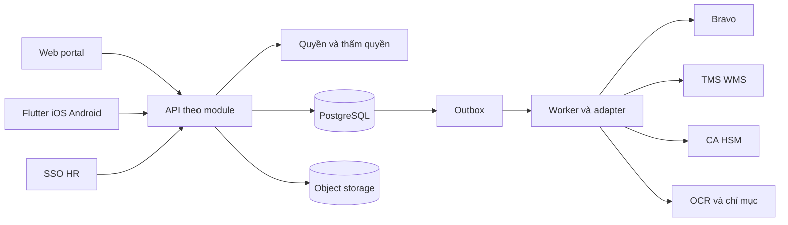

# Kế hoạch triển khai E Office Vinafco

Ngày lập 02/11/2026. Trạng thái đề xuất để chốt phạm vi và tổ chức coding. Đối tượng sử dụng là chủ sản phẩm, BA, người phát triển, QA và coding agent.

Đề xuất xây E Office quanh **hồ sơ nghiệp vụ có phiên bản**, dùng một backend chia module, một web portal và ứng dụng mobile dùng chung hợp đồng API. Triển khai nền tổ chức, quyền, tài liệu và quy trình trước; tiếp đến tài chính và Bravo; sau đó hoàn thiện kho dữ liệu, mobile native, văn bản, công việc, dự án và tiện ích. Mỗi công việc có đầu ra, phụ thuộc, tiêu chí nghiệm thu và cách xác minh.

Backlog gồm **80 công việc**, truy vết tới **54 mã yêu cầu chức năng và phi chức năng của SRS** cùng **6 kịch bản UAT**. Toàn bộ đang ở `not-started`. Đây là kế hoạch greenfield vì workspace hiện có Git nhưng chưa có source ứng dụng. Các đường dẫn source, API và lệnh kiểm tra dưới đây là thiết kế dự kiến.

## 1 Nguồn và cách chốt baseline

| Nguồn đã đọc | Vai trò trong kế hoạch |
| --- | --- |
| [Harness Template](<C:/Users/PC/Desktop/AI Agent/Harness Template/README.md>) cùng agents.md, hai bộ feature list/schema, init.ps1, init.sh, progress.md và session-handoff.md | Tham chiếu quy trình làm việc, lưu trạng thái và xác minh. |
| [SRS v2.0](<D:/Downloads/VFC_EOffice_SRS_v2_0.docx>) ngày 02/11/2026 | Danh mục hành vi, ranh giới hệ thống, yêu cầu nghiệm thu và QD-01 đến QD-07. |
| [Thiết kế sản phẩm](<C:/Users/PC/.gemini/antigravity/brain/e3178b70-86b1-4182-9390-50937ab0a561/thiet_ke_san_pham_eoffice_vinafco.md>) | Định hướng nhận diện, trải nghiệm và ba kịch bản showcase. |

Giữ nguyên cách phân loại của SRS: **YCG** là yêu cầu có nguồn nhưng còn cần chi tiết triển khai; **TL** là nội dung trao đổi cần xác nhận; **ĐX** là thiết kế đề xuất. Mã SRS được giữ nguyên để truy vết, không mặc nhiên biến TL/ĐX thành yêu cầu đã phê duyệt. Tài liệu yêu cầu gốc được SRS nhắc tới chưa nằm trong bộ nguồn đã đọc lần này.

Các chỉ dẫn trong Harness Template là nội dung tham khảo để thiết kế quy trình tương lai. Việc đọc template không tự kích hoạt cài dependency, chạy script, commit, kết nối dịch vụ hay triển khai sản phẩm trong lần lập kế hoạch này.

### Những điểm cần điều chỉnh giữa thiết kế và SRS

| Nội dung thiết kế | Quy tắc triển khai theo SRS |
| --- | --- |
| Luôn đối soát ba bên và tự chuyển Bravo | Đối soát các thành phần áp dụng cho từng loại giao dịch; có trường hợp không PO, tạm ứng, thiếu dữ liệu hoặc ngoại lệ. Bravo tiếp tục sở hữu hạch toán. |
| SHA-256 chứng minh hóa đơn độc bản/chưa thanh toán | Hash kiểm tra byte và toàn vẹn. Trùng nghiệp vụ dùng khóa hóa đơn được chốt; tình trạng thanh toán cần dữ liệu nguồn. |
| Bút toán hiện ngay sau một lần bấm | Có bước chờ nhận, đã nhận, đã xác nhận, lỗi hoặc chưa rõ kết quả. Chỉ hiện số Bravo khi nguồn trả về. |
| Làm mờ hàng kết quả ngoài quyền | Production không trả hàng, tên, snippet, số đếm hay quan hệ ngoài quyền; hàng làm mờ chỉ dùng trong showcase với dữ liệu giả. |
| WORM 10 năm và PDF/A cho toàn bộ kho | Chốt hạn lưu theo loại và chính sách Vinafco. Đánh giá WORM theo hạ tầng; luôn giữ bản gốc, bản chuyển đổi là dẫn xuất. |
| Một MST là khóa cho mọi đối tác | BusinessPartner có ID nội bộ, nhiều định danh và mã nguồn; không ép cá nhân hay pháp nhân nhiều MST vào một khóa không phù hợp. |
| FaceID và animation con dấu là ký số | Tách xác thực thiết bị, quyết định nội bộ và kết quả ký số được nhà cung cấp xác nhận/xác minh. |
| Duyệt trong 5 giây, tìm 0,5 giây, giảm 80%, triển khai 2,5 tháng | Là mục tiêu trình diễn/tiếp thị. Chỉ chuyển thành chỉ tiêu nghiệm thu sau khi chốt tải, phạm vi, mẫu đo và điều kiện. |
| Ngân sách còn 45% | Chỉ hiển thị khi có nguồn ngân sách, kỳ và thời điểm cập nhật; thiếu nguồn thì ghi chưa có dữ liệu. |

## 2 Phạm vi phát hành

| Mốc | Kết quả sử dụng được | Điều kiện ra khỏi mốc |
| --- | --- | --- |
| M0 nền dự án | Fresh checkout chạy được web/API/worker, DB/storage, harness và fixture. | P0 hoàn tất; lệnh kiểm tra thực sự phát hiện lỗi. |
| M1 pilot trình duyệt | Tờ trình, tài liệu, quy trình, inbox, ủy quyền, thay đổi bản trình và hồ sơ chốt trên web/điện thoại. | P1/P2 trong phạm vi pilot; nghiệp vụ và ma trận quyền được duyệt. Ký số thật cần feat-032 nếu loại hồ sơ yêu cầu. |
| M2 pilot tài chính | Vận tải hoặc mua bán nhiều đợt, XML/OCR, đối soát, ngoại lệ, phân bổ và Bravo. | P3, UAT-01/UAT-02, kết nối sandbox thật và đối soát số liệu. |
| M3 kho dữ liệu và mobile | Chuyển đổi dữ liệu, kiểm toán có thời hạn, bàn giao dữ liệu, iOS/Android và ký từ thiết bị. | P4/P5, UAT-03/UAT-04/UAT-05 và kiểm thử thiết bị thật. |
| M4 phạm vi đầy đủ | Văn bản, hợp đồng, công việc, dự án, tiện ích và vận hành production. | P6/P7, UAT-06, kiểm bảo mật/hiệu năng/khôi phục và quyết định go-live. |

M1 chỉ nghiệm thu phần trình duyệt nội bộ thuộc UAT-02/UAT-04. Chưa có tài chính, Bravo hoặc app native thì không ghi hai UAT này đã hoàn tất toàn bộ. Các mốc production phải bổ sung các kiểm tra bảo mật, sao lưu, giám sát tối thiểu của P7 ngay tại mốc đó; P7 là đợt kiểm tra tổng thể cuối.

Chưa đưa vào phạm vi mặc định: thay thế Bravo, TMS/WMS; payroll; AI tự quyết định duyệt; workflow engine hỗ trợ toàn bộ BPMN; tìm kiếm ngữ nghĩa; data warehouse; mọi hệ thống ngoài đều duyệt hai chiều. Bổ sung các phần này qua thay đổi phạm vi.

## 3 Kiến trúc đề xuất

### Lựa chọn công nghệ để kiểm chứng ở P0

| Thành phần | Đề xuất | Lý do và điều kiện |
| --- | --- | --- |
| Web | React và Next.js, TypeScript | Portal responsive, route theo nghiệp vụ, thư viện UI chung. Nếu self-host, đặt reverse proxy phía trước và kiểm soát cache dữ liệu riêng tư theo [tài liệu Next.js](https://nextjs.org/docs/app/guides/self-hosting). |
| API | NestJS, REST và OpenAPI | Một backend chia module theo miền; module xuất interface rõ ràng, phù hợp cơ chế đóng gói của [NestJS](https://docs.nestjs.com/modules). |
| Dữ liệu | PostgreSQL, migration SQL có kiểm soát | Transaction, constraint và truy vấn quan hệ; cân nhắc RLS như lớp bảo vệ bổ sung. Application role không là owner/superuser hoặc có BYPASSRLS; xem [PostgreSQL RLS](https://www.postgresql.org/docs/current/ddl-rowsecurity.html). |
| Tác vụ nền | Worker riêng; transactional outbox trong DB, BullMQ và Redis nếu spike chấp thuận | Queue không là bản ghi duy nhất của nghiệp vụ. Job nhỏ và có tính idempotent để retry theo [hướng dẫn BullMQ](https://docs.bullmq.io/patterns/idempotent-jobs). |
| Tệp | Object storage qua StoragePort | Chọn theo hạ tầng, dữ liệu và chi phí. Nếu cần WORM, kiểm tra retention và legal hold trên từng object version, như cơ chế [S3 Object Lock](https://docs.aws.amazon.com/AmazonS3/latest/userguide/object-lock.html); không suy ra mọi storage tương thích S3 có cùng khả năng. |
| Tìm kiếm | Metadata và full text ở PostgreSQL trước; SearchPort cho phần thay thế | Đo tiếng Việt, ACL và tải thực tế; chỉ bổ sung search cluster khi có nút thắt đã đo. |
| Mobile | Flutter cho iOS/Android, xác nhận ở QD-04 | Phù hợp hướng thiết kế. Dữ liệu được phép có thể cache đọc; quyết định/ký chỉ ghi khi server xác nhận, theo biến thể online-only writing trong [Flutter architecture](https://docs.flutter.dev/app-architecture/design-patterns/offline-first). |
| Kiểm thử | Unit cho rule; integration với DB thật; contract cho adapter; E2E web/mobile | Tập trung vào quyền, trạng thái, đồng thời và kết quả quan sát được. Công cụ cụ thể và phiên bản khóa tại P0. |
| Triển khai | Container cho web/API/worker; môi trường dev, staging và production tách biệt | Chốt on-prem/cloud, quản lý bí mật, sao lưu và CI phù hợp QD-06. Chưa cần Kubernetes khi quy mô chưa chứng minh nhu cầu. |

Stack trên là phương án kỹ thuật, SRS chưa bắt buộc framework. Feat-002 phải chứng minh khả năng build, giao dịch, RLS, storage và adapter; sau đó ghi ADR, phiên bản được hỗ trợ và lockfile. Không chọn phiên bản chỉ vì nhãn latest.



Backend là modular monolith: các module nghiệp vụ dùng chung DB có giao dịch rõ ràng; adapter và worker tách phần chờ bên ngoài. Không tách microservice chỉ theo số lượng module. Web/mobile cùng gọi API nghiệp vụ, không tự thực thi quy tắc duyệt. UI có thể dùng BFF để quản lý phiên web nhưng không tạo bản sao logic nghiệp vụ.

### Cấu trúc thư mục dự kiến

```text
AGENTS.md
feature_list.json
feature_list.schema.json
progress.md
session-handoff.md
init.ps1
init.sh
apps/
  web/src/features/
  api/src/modules/
  api/src/adapters/
  worker/src/jobs/
  mobile/lib/
packages/
  api-contracts/
  database/migrations/
  database/policies/
  design-tokens/
  ui/
scripts/verify-harness/
scripts/verify-feature/
tests/fixtures/
tests/integration/
tests/contracts/
tests/e2e/
tests/security/
tests/performance/
tools/migration/
tools/data-portability/
infra/
docs/requirements/
docs/architecture/
docs/decisions/
docs/integrations/
docs/uat/
docs/runbooks/
```

Tách domain, application, persistence và adapter trong module khi có logic cần thiết; không tạo lớp trống chỉ để đủ sơ đồ. TypeScript dùng chung DTO/schema khi phù hợp; client Dart sinh từ OpenAPI, không cố dùng trực tiếp mã TypeScript trong Flutter.

## 4 Ranh giới module và dữ liệu

| Module | Sở hữu dữ liệu và quy tắc | Liên hệ chính |
| --- | --- | --- |
| Organization và Identity | LegalEntity, OrganizationUnit, Person, RoleAssignment, Session, Device | Nguồn cho policy, resolver người duyệt và thu hồi phiên. |
| Authorization và Authority | AuthorityRule, Delegation, AccessGrant | Đánh giá vai trò, phạm vi, độ mật, hành động và hiệu lực. |
| Forms và Rules | FormDefinitionVersion, RuleSetVersion, MetadataTemplateVersion | Phiên bản cấu hình gắn vào bản trình. |
| Workflow và Approval | WorkflowDefinitionVersion, WorkflowInstance, StepInstance, ApprovalTask, Decision | Trạng thái thực thi và bằng chứng quyết định. |
| Dossier | CaseDossier, CaseLink, DossierRevision, CompletionSnapshot | Hồ sơ tổng hợp, quy trình con, chốt và điều chỉnh. |
| Documents và Retention | Document, DocumentVersion, StoredObject, DocumentReference, MetadataValue, RetentionPolicy, LegalHold | Bản gốc, phiên bản, quan hệ sử dụng và vòng đời. |
| Master Data | BusinessPartner, PartnerIdentifier, ExternalCodeMap | Ánh xạ có hiệu lực và lịch sử xác nhận. |
| Finance | Invoice, InvoiceLine, Allocation, PaymentRequest, ReconciliationIssue, ExceptionRequest, BudgetSnapshot | Đối soát chứng từ và theo dõi số tiền theo từng giai đoạn. |
| Contract và Correspondence | Contract, ContractAmendment, Correspondence, NumberRegister | Hợp đồng, công văn, cấp số và phát hành. |
| Work và Utilities | WorkItem, WorkMetricRule, Project, Milestone, Resource, Booking, BusinessTrip | Công việc người dùng, dự án, lịch xe/phòng và công tác. |
| Signature | SignatureRequest, SignatureRecord | Yêu cầu ký, bản đầu vào, kết quả xác minh và artifact. |
| Integration và Audit | IntegrationMessage, OutboxEvent, InboxReceipt, ExternalReference, AuditEvent | Giao nhận, chống lặp, đối soát và bằng chứng vận hành. |

Các thực thể bổ sung như StepInstance, StoredObject, BudgetSnapshot và LegalHold là đề xuất kỹ thuật để hiện thực yêu cầu; không phải thực thể SRS đã chốt. Đặt `ApprovalTask` và `WorkItem` khác nhau để tránh lẫn việc phê duyệt với công việc dự án.

### Quy tắc thiết kế bảng

1. ID nội bộ không phụ thuộc mã Bravo, MST hay số hóa đơn; mã người dùng và mã nguồn là thuộc tính có phạm vi/constraint riêng.
2. Dữ liệu nghiệp vụ có `legal_entity_id`, chủ sở hữu, độ mật và revision khi cần. Tham chiếu chéo pháp nhân chỉ hợp lệ nếu policy cho phép; kiểm cả hai đầu quan hệ.
3. RoleAssignment, Delegation và bảng quy tắc có ngày hiệu lực. Quyết định lưu bằng chứng thẩm quyền tại lúc thực hiện, không chỉ lookup trạng thái hiện tại.
4. Phiên bản form, workflow và rule đã publish là bất biến; hồ sơ tham chiếu ID phiên bản. Việc chuyển phiên bản là hành động có audit.
5. Tiền dùng kiểu thập phân chính xác, đơn vị tiền và quy tắc làm tròn được chốt. Không dùng float JavaScript cho phép cộng/so sánh tiền. Tách số đã duyệt, đã chuyển Bravo và đã thanh toán.
6. DocumentVersion giữ object key, object version, hash, kích thước, MIME, nguồn và trạng thái kiểm tra. Giữ nguyên byte XML/PDF đã ký; preview/OCR/PDF chuyển đổi là object dẫn xuất.
7. DocumentReference của bản trình/snapshot ghim phiên bản cụ thể. Nếu màn hình dùng bản hiệu lực mới nhất thì phải thể hiện rõ; không tự đổi bản đã duyệt.
8. Mọi khóa chống lặp có phạm vi và request fingerprint. Cùng khóa nhưng nội dung khác phải bị từ chối; duplicate operation trả kết quả cũ theo quyền người yêu cầu.
9. Migration có kế hoạch forward/backward compatibility; seed dev/test không chạy mặc định ở production. Sự kiện và quyết định quan trọng được ghi transactionally.

### Các trạng thái độc lập

| Đối tượng | Trạng thái dự kiến | Quy tắc |
| --- | --- | --- |
| Hồ sơ | draft, processing, awaiting-supplement-or-exception, completed, locked, cancelled, replaced | Chốt hồ sơ phải đủ kết quả bắt buộc; sau khóa đi qua điều chỉnh/phụ lục. |
| ApprovalTask | pending, approved, rejected, returned, withdrawn, superseded | Task đã thay thế không nhận quyết định mới. |
| Yêu cầu tích hợp | queued, sending, received, confirmed, failed, unknown, reconciliation-required | Ack nhận không đồng nghĩa nguồn đã hoàn tất nghiệp vụ; timeout có thể là unknown. |
| Yêu cầu ký | requested, awaiting-auth, processing, verified, failed, cancelled, unknown | Chỉ verified sau xác minh kết quả đúng phiên bản đầu vào. |
| Chất lượng dữ liệu | pending, needs-review, verified, rejected | OCR/parsing chưa xác nhận không tự thành bằng chứng đạt chuẩn. |

Tên trạng thái kỹ thuật sẽ chốt trong ADR; phải ánh xạ được về nghĩa của SRS. Phê duyệt nội bộ, ký số, gửi Bravo và đã chi tiền là các trục trạng thái riêng, không gom vào một cờ `approved`.

## 5 Hợp đồng API và xử lý giao dịch

API có prefix `/api/v1`, OpenAPI được version hóa, phân trang có giới hạn, correlation ID và cấu trúc lỗi dùng chung. Context vai trò/pháp nhân từ lựa chọn người dùng phải được server xác minh với phiên và role assignment; không tin header do client tự khai.

| Nhóm | API dự kiến | Điểm bắt buộc |
| --- | --- | --- |
| Ngữ cảnh | GET /me, GET /me/contexts, POST /sessions/revoke | Phân biệt người, vai trò đang chọn, pháp nhân và thiết bị. |
| Cơ cấu | /legal-entities, /organization-units, /role-assignments | Hiệu lực, cây không vòng và phân quyền quản trị. |
| Thẩm quyền | /delegations, /authority-rules, /access-grants | Hạn mức, thời hạn, căn cứ và thu hồi. |
| Cấu hình | /form-versions, /workflow-versions, /rule-set-versions | Nháp, validate, simulate và publish phiên bản. |
| Hồ sơ | POST /dossiers, GET /dossiers/:id, POST /dossiers/:id/submit | Revision, form/rule/workflow version và chứng từ áp dụng. |
| Quyết định | GET /approval-tasks, POST /approval-tasks/:id/decisions | expectedRevision, snapshotId, operationId, loại hành động và ý kiến. |
| Sửa dữ liệu | PATCH /dossiers/:id, POST /dossiers/:id/withdraw | Khóa lạc quan, phân loại thay đổi và vô hiệu hóa task cũ. |
| Chốt | POST /dossiers/:id/complete, POST /dossiers/:id/amendments | Điều kiện chốt, snapshot và căn cứ sửa sau khóa. |
| Tệp | /file-intakes, /documents, /documents/:id/versions | Quarantine, metadata, hash và quyền tệp. |
| Tìm kiếm | GET /documents/search | ACL trước kết quả, count, facet, snippet và gợi ý. |
| Hóa đơn | /invoices, /invoices/:id/extraction-reviews | Nguồn trường, xác nhận, khóa nghiệp vụ và quan hệ thay thế. |
| Tài chính | /allocations, /matching-runs, /exception-requests | Decimal, version rule và kiểm soát request cạnh tranh. |
| Ký | POST /signature-requests, GET /signature-requests/:id | Hash đầu vào, xác thực và kết quả xác minh. |
| Tích hợp | GET /operations/:id, /integration-issues, /reconciliations | Trạng thái bền vững, quyền retry và lịch sử xử lý. |
| Xuất | POST /export-jobs, GET /export-jobs/:id | Đánh giá quyền khi yêu cầu, khi chạy và khi tải. |
| Booking | /resources, /bookings | Constraint khoảng thời gian và trạng thái xác nhận. |

Mã lỗi nghiệp vụ dự kiến: `FORBIDDEN`, `STALE_SNAPSHOT`, `AUTHORITY_EXPIRED`, `VALIDATION_FAILED`, `DUPLICATE_OPERATION`, `DUPLICATE_INVOICE_REVIEW_REQUIRED`, `SOURCE_CONFIRMATION_PENDING`, `CONFLICTING_BOOKING`. Nội dung lỗi ngoài quyền phải tránh tiết lộ đối tượng có tồn tại hay thông tin hồ sơ khác.

### Transaction của một quyết định

1. Xác thực phiên, người thực hiện và context đã được phép.
2. Tra operation ID trong phạm vi; nếu đã có, kiểm quyền rồi trả kết quả đã ghi.
3. Khóa/kiểm revision của task và hồ sơ; đối chiếu snapshot, phiên bản chứng từ và trạng thái còn chờ.
4. Kiểm lại vai trò, hạn mức, ủy quyền và quy tắc tại thời điểm transaction. Với hành động nhạy cảm, dữ liệu thu hồi quyền phải tham gia cùng cơ chế đồng thời để không lọt request cạnh tranh.
5. Ghi Decision cùng bằng chứng thẩm quyền và snapshot; cập nhật task, workflow và revision.
6. Ghi AuditEvent và OutboxEvent cùng transaction, commit rồi trả operation ID/trạng thái.
7. Worker thực hiện bước ngoài hệ thống; chỉ cập nhật confirmed sau bằng chứng nguồn. Client tra operation khi timeout.

Sự kiện chính gồm DossierSubmitted, ApprovalTaskOpened, DecisionRecorded, MaterialChangeDetected, ChildWorkflowRequested, DossierCompleted, SignatureVerified, DocumentSuperseded, InvoiceFlaggedDuplicate, BravoSubmissionRequested và ExternalStateMismatchDetected. Event chứa ID, scope, version, actor và correlation ID; không mặc định sao chép toàn bộ tài liệu vào message.

## 6 Tích hợp và chủ dữ liệu

| Nguồn | E Office cần | Chủ dữ liệu và phương án khi thiếu kết nối |
| --- | --- | --- |
| SSO và HR | Danh tính, cơ cấu, vai trò, tình trạng làm việc, thu hồi phiên | Chốt nguồn chuẩn, chiều sync và ngưỡng thu hồi. Dev identity chỉ phục vụ local/test. |
| Bravo | Đối tượng nghiệp vụ cần gửi, ack, số chứng từ/bút toán, trạng thái thanh toán nếu có | Bravo giữ hạch toán. Nếu dùng file trao đổi, kiểm schema, batch ID, checksum, ack và đối soát; không giả có REST API. |
| TMS/WMS | Mã chuyến, dịch vụ, nghiệm thu và nguồn chứng từ | TMS/WMS giữ nghiệp vụ vận hành. Chưa có API thì dùng nhập có xác nhận theo quy trình được duyệt. |
| CA/HSM | Yêu cầu ký, xác thực, tài liệu ký, chứng thư và xác minh | Nhà cung cấp/chính sách ký chốt tại QD-04. Adapter fake chỉ dùng test. |
| OCR | Trường trích xuất, vị trí nguồn, confidence | E Office quản lý người xác nhận. Chọn xử lý local/cloud theo quyền dữ liệu và hạ tầng. |
| Nguồn phê duyệt ngoài khác | Capability, yêu cầu, version, quyết định, ack và đối soát | Chốt riêng từng nguồn: thông báo; xem/chuyển nguồn; hoặc quyết định hai chiều. |

Mỗi kết nối phải có contract về trường/kiểu, mã chuẩn, nguồn chuẩn, chiều sync, trigger/lịch, auth, timeout, mã lỗi, giới hạn tải, xử lý lặp, versioning và trách nhiệm của Vinafco, bên E Office và bên nguồn.

Thiết kế giao nhận giả định **có thể gửi/nhận nhiều lần**. Đảm bảo không tạo tác dụng phụ trùng bằng khóa nghiệp vụ, idempotency của nguồn hoặc tra cứu/đối soát trước khi gửi lại. Khi Bravo không hỗ trợ chống lặp lẫn tra cứu kết quả, không thể cam kết tự động exactly-once; giao dịch chưa rõ kết quả phải dừng ở hàng chờ đối soát có người xử lý.

Webhook/callback phải xác thực nguồn, chống replay và đối chiếu operation, document hash/version, actor/cert khi có. Không tin payload callback chỉ vì biết ID giao dịch. Mọi retry thủ công cũng tuân thủ policy và có audit.

## 7 Màn hình và tiêu chuẩn trải nghiệm

| Nhóm màn hình | Nội dung và hành động chính |
| --- | --- |
| Đăng nhập và context | SSO, chọn vai trò/pháp nhân, phiên/thiết bị, ủy quyền hiệu lực. |
| Trang công việc | Việc chờ duyệt, việc được giao, quá hạn, hồ sơ cần bổ sung; số liệu chỉ trong quyền. |
| Danh sách và chi tiết hồ sơ | Bộ lọc, timeline, quy trình con, chứng từ, diff, cảnh báo, snapshot chốt. |
| Inbox và quyết định | Bản trình, số tiền, căn cứ, ý kiến, bản xem, duyệt/từ chối/trả lại và trạng thái xác nhận. |
| Tạo hồ sơ và form admin | Runtime form, tệp, chứng từ theo điều kiện; editor, preview và publish form/rule. |
| Quy trình admin | Definition, vai trò, điều kiện, song song, mô phỏng và phiên bản. |
| Kho tài liệu | Thư mục/góc nhìn, metadata, version, tham chiếu, chất lượng, hiệu lực và quyền. |
| Tài chính | Intake XML/OCR, xác nhận trường, nghi trùng, đối soát giải thích, phân bổ, ngoại lệ và ngân sách có nguồn. |
| Tích hợp vận hành | Ack, số Bravo, unknown, lỗi, retry, dead-letter và báo cáo chênh lệch. |
| Kiểm toán | Mã tra cứu, scope, snapshot, quyền có hạn và xuất manifest. |
| Hợp đồng và văn bản | Hiệu lực/phụ lục, rà soát/ký, số đến/đi, bản phát hành, nơi nhận. |
| Công việc và dự án | Người phụ trách, bằng chứng, hạn, mốc, tiến độ và công thức chỉ tiêu. |
| Tiện ích | Lịch xe/phòng, xung đột, duyệt, công tác và liên kết tài chính. |
| Mobile native | Inbox có capability nguồn, chi tiết đúng version, ký thật, trạng thái mạng và thiết bị. |

Token gốc theo thiết kế: nền `#001A45`, panel `#012B73`, accent `#6CB4FC`, màu rà soát `#B4692E` hoặc `#E0A36A`, chữ `#F5F4EF`, phụ/viền `#A9B9D4`. Dùng Be Vietnam Pro cho nội dung, IBM Plex Mono cho mã/số, Source Serif 4 cho trích dẫn khi cần. Kiểm giấy phép/đóng gói font và độ tương phản ở P0; không dùng màu làm tín hiệu duy nhất.

Showcase là màn hình riêng với dữ liệu tổng hợp, reset được và không phát lệnh thật tới Bravo/CA. Có thể dùng ba câu chuyện 3-way matching, graph tham chiếu và mobile theo tài liệu thiết kế. Giao diện tác nghiệp dùng đầy đủ nhãn, thông tin và trạng thái; quy tắc 3–7 từ và thanh placeholder chỉ áp dụng cho bố cục trình diễn. Animation thành công trong tác nghiệp chỉ xuất hiện khi operation đạt trạng thái tương ứng.

Mọi màn hình cần loading, empty, validation, forbidden, stale, network error và thao tác khôi phục phù hợp. Chuẩn lưu thời gian là UTC; timezone tác nghiệp và lịch đặt tài nguyên chốt với Vinafco, dự kiến Asia/Ho_Chi_Minh. Đây là cấu hình sản phẩm, độc lập timezone của người đang lập kế hoạch.

## 8 Thứ tự coding và ước lượng

| Giai đoạn | Feature | Số việc | Ngày công dự kiến | Đầu ra |
| --- | --- | --- | --- | --- |
| P0 | feat-001 đến feat-006 | 6 | 5,5–11 | Khởi tạo và harness |
| P1 | feat-007 đến feat-018 | 12 | 20–35 | Tổ chức quyền và tài liệu nền |
| P2 | feat-019 đến feat-034 | 16 | 31–57 | Biểu mẫu quy trình và pilot |
| P3 | feat-035 đến feat-049 | 15 | 32–61 | Tài chính hợp đồng và Bravo |
| P4 | feat-050 đến feat-059 | 10 | 20–37,5 | Kho dữ liệu và kiểm toán |
| P5 | feat-060 đến feat-066 | 7 | 13–26 | Mobile native |
| P6 | feat-067 đến feat-073 | 7 | 13,5–26 | Văn bản công việc và tiện ích |
| P7 | feat-074 đến feat-080 | 7 | 16–30,5 | Tích hợp mở rộng và phát hành |
| Tổng | feat-001 đến feat-080 | 80 | 151–284 | Toàn bộ phạm vi đề xuất |

Ngày công là ước lượng kỹ thuật cho thực hiện và kiểm tra trong feature, không phải thời gian chạy của AI hay báo giá. Khoảng ước lượng còn phụ thuộc dữ liệu mẫu, số loại quy trình, API, chính sách ký và số kênh nhận tài liệu. Feat-074 hiện là khoản dự trù cho một nguồn ngoài được chọn; thêm nguồn cần estimate riêng. Thời gian chờ nhà cung cấp chưa được tính.

Với một luồng làm việc tuần tự và năng lực khoảng một ngày công mỗi ngày, tổng 151–284 ngày công tương đương khoảng 30–57 tuần làm việc trước thời gian chờ. Nên dự phòng thêm 15–25% cho các bất định tích hợp và dữ liệu sau khảo sát, không cộng lại thời gian kiểm thử đã có trong feature. Không lấy số người chia trực tiếp vì Harness đang quy định một feature đang làm tại một thời điểm.

Pilot P0–P2 không có ký số thật gồm 33 việc, 53,5–97 ngày công. Nếu hồ sơ pilot bắt buộc ký số thì thêm feat-032, thành 56,5–103 ngày công. Vì vậy mốc 2,5 tháng trong bản thiết kế chỉ nên đặt làm mục tiêu cho phạm vi pilot thu gọn sau QD-01; chưa đủ cơ sở cam kết cho toàn hệ thống. Đo lại ước lượng sau 3–5 feature hoàn tất, dựa trên thời gian thực và lỗi phát hiện.

Ưu tiên trong khoảng 10 ngày công đầu: hoàn thành P0 ở mức có thể kiểm chứng, chốt các đầu vào còn thiếu và bắt đầu nền tổ chức nếu có năng lực còn lại. Không cam kết xong một module nghiệp vụ chỉ dựa vào số phiên chat.

### Backlog có thể giao trực tiếp

- [Chi tiết 80 công việc và ma trận truy vết](./BACKLOG_VI.md).
- [Feature list đề xuất cho coding agent](./feature_list.proposed.json).
- [Schema đề xuất](./feature_list.schema.proposed.json).

Mỗi feature có phạm vi code, dependencies, mã nguồn yêu cầu, tiêu chí nghiệm thu, estimate, QD liên quan và lệnh kiểm tra dự kiến. Những việc nhiều ngày có thể phân rã thêm trước khi code, nhưng chỉ duy trì một feature đang làm và không hạ tiêu chí nghiệm thu để đánh dấu xong.

Chuỗi ưu tiên là **P0 → tổ chức/quyền/tài liệu → form/quy trình/duyệt → hồ sơ và thay đổi bản trình → tài chính/Bravo → kho dữ liệu/mobile → các phân hệ còn lại → nghiệm thu tổng thể**. Schema và dependency graph cụ thể nằm trong JSON; lịch chọn việc dựa vào dependency thực tế, không chỉ số thứ tự phase.

## 9 Harness áp dụng cho dự án

### Những điểm cần sửa trước khi đưa vào sử dụng

| Quan sát trong template | Sửa ở feat-004 |
| --- | --- |
| Có cả feature_list.json và feature-list.json, mỗi loại có schema tương ứng | Dùng một bộ canonical có dấu gạch dưới; không duy trì hai nguồn trạng thái. |
| File thực tế là agents.md còn README gọi AGENTS.md | Chuẩn hóa casing AGENTS.md để hoạt động nhất quán trên filesystem phân biệt hoa thường. |
| init.ps1 bọc native command trong try/catch nhưng không kiểm `$LASTEXITCODE` | Wrapper bắt exit code ngay sau mỗi lệnh và trả nonzero; kiểm thử bằng lệnh chủ động thất bại. |
| Nhánh nhận diện .NET trong PowerShell dùng lệnh Get-ChildItem với tham số không phù hợp | Thay autodetection rộng bằng các lệnh stack đã chốt của dự án; nếu giữ thì sửa và kiểm nhánh tương ứng. |
| Manifest/check không tồn tại có thể đi tới dòng ALL VERIFICATION CHECKS PASSED | Thiếu điều kiện bắt buộc phải thất bại; ghi từng check đã chạy và không coi skip là pass. |
| Script tự install dependency mỗi lần baseline | Tách bootstrap và verify; dùng lockfile, cài có kiểm soát, không âm thầm đổi dependency trong kiểm tra. |
| progress và handoff mẫu có dấu hoàn thành/PASS | Khởi tạo NOT RUN và nội dung trống có nghĩa; chỉ ghi PASS sau lệnh thật. |
| Schema mới mô tả cấu trúc, chưa kiểm quan hệ giữa feature | Validator thêm ID duy nhất, dependency tồn tại/không vòng, một in-progress, và done có evidence/commit. |
| Chọn việc không xét QD hoặc trạng thái blocked một cách đầy đủ | Chỉ chọn việc có dependencies done và đủ đầu vào; ghi blocker cụ thể cho việc phụ thuộc vendor/chính sách. |

Tài liệu cần đọc khi bắt đầu phiên: AGENTS.md → phạm vi/ADR có liên quan → feature_list.json → progress/handoff → baseline và Git. Chỉ mở phần yêu cầu của feature đang làm. Khi đã có code và CodeGraph sẵn sàng, dùng CodeGraph cho tra cứu cấu trúc; ghi việc khởi tạo chỉ mục vào quy trình thiết lập nếu chưa có.

### Lệnh cần hiện thực

```powershell
# Cài đặt riêng khi bootstrap, với lockfile đã tạo và khóa phiên bản
pnpm install --frozen-lockfile

# Baseline dự án trên Windows
powershell -ExecutionPolicy Bypass -File ./init.ps1

# Các script này sẽ được xây ở P0, chưa tồn tại trong repo hiện tại
pnpm harness:validate
pnpm typecheck
pnpm lint
pnpm test:unit
pnpm test:integration
pnpm test:e2e
pnpm verify:feature --id feat-026
pnpm build
```

Runner Linux phải gọi cùng tập kiểm tra tương đương qua init.sh. `verify:feature` ánh xạ feature ID tới kiểm tra liên quan, ghi command, thời gian, exit code và vị trí evidence; từ chối ID chưa có cấu hình kiểm tra. Không dùng một script luôn exit 0 để hoàn tất backlog. Khi thêm Flutter, wrapper gọi analyze/test và kiểm build tương ứng; iOS cần môi trường macOS được bố trí riêng.

Ba việc bootstrap đầu tiên dùng kiểm tra riêng được tạo ngay trong việc đó: feat-001 kiểm sổ quyết định và review nội dung, feat-002 chạy script spike, feat-003 dùng `pnpm verify:bootstrap` để build và kiểm tra health. Feat-004 mới chuẩn hóa init.ps1/init.sh trên nền kiểm tra thật đã có; feat-005 mở rộng dispatcher và các tầng test. Cách khởi tạo này tránh phụ thuộc vào lệnh chưa được tạo. Trước khi có manifest, trạng thái nền là chưa sẵn sàng, không phải PASS.

Baseline mặc định gồm kiểm schema/trạng thái, typecheck, lint, test nền có ý nghĩa và build. Integration/E2E cần hạ tầng local sẵn sàng, không tự sửa dữ liệu thật. Trước khi done chạy kiểm tra hành vi của feature và regression liên quan. Test bảo mật, đồng thời và tích hợp đặt ngay khi xây luồng; các đợt P7 bổ sung kiểm tổng thể.

### Định nghĩa hoàn tất

Feature chỉ done khi hành vi và tiêu chí trong baseline được hiện thực, lệnh kiểm tra thực sự đạt, evidence chỉ tới đầu ra có thể kiểm lại, tài liệu trạng thái đã cập nhật và code đã commit. Các mục kết nối thật cần bằng chứng sandbox/provider; unit test với fake chỉ chứng minh logic adapter.

`commit` tham chiếu commit chứa phần triển khai. Có thể ghi SHA vào lượt đồng bộ trạng thái kế tiếp để tránh yêu cầu một commit tự chứa hash của chính nó. Không tự commit tài liệu kế hoạch trong lần lập kế hoạch này.

Ở phiên code bị chặn: giữ một feature in-progress hoặc chuyển blocked với nguyên nhân/đầu vào thiếu; không ghi done vì đã dựng UI/mock. Nếu tiếp tục một feature độc lập, phải kết thúc/đóng trạng thái đang làm theo hợp đồng harness. Handoff nêu việc đã thực hiện, kiểm tra gần nhất, phần chưa xong và bước kế tiếp cụ thể.

## 10 Kiểm thử và nghiệm thu

| Kịch bản SRS | Feature chính | Bằng chứng cần thu |
| --- | --- | --- |
| UAT-01 chi phí vận tải | 036–048 | Chứng từ nguồn, trùng/lệch, ngoại lệ, quyết định, ack/số Bravo và gói xuất. |
| UAT-02 mua bán nhiều quy trình | 019–035, 036, 042, 045–048 | Trình tự đề xuất/hợp đồng/tạm ứng/hoàn ứng/thanh toán, số dư và bộ hồ sơ theo mã/bút toán. |
| UAT-03 hợp đồng nhiều nơi dùng | 014–016, 035, 051–053, 059 | Một bản gốc, phụ lục/hiệu lực, cảnh báo và truy vấn ngoài quyền không lộ dữ liệu. |
| UAT-04 mobile và ủy quyền | 007–010, 026–032, 060–066 | Hai context pháp nhân, thu hồi/expiry, phiên bản tài liệu, thiết bị thật, timeout/retry và kết quả ký. |
| UAT-05 dữ liệu cũ và kiểm tra | 038, 050, 054–059 | Nhập thiếu/trùng, chỉnh OCR, kiểm kê, khóa/hold và grant có hạn. |
| UAT-06 hành chính | 067–073 | Công văn đến/câu trả lời, công văn phát hành đúng bản ký và số, tiến độ dự án, booking cạnh tranh. |

Ma trận đầy đủ 54 mã nằm cuối BACKLOG_VI.md. Khi QD thay đổi baseline phải cập nhật feature, test và UAT bị ảnh hưởng trong cùng lượt thay đổi phạm vi.

### Các trường hợp bắt buộc kiểm tra sớm

- Người có hai vai trò đổi context, mở URL cũ hoặc chạy job xuất sau khi mất quyền; kiểm cả list/count/gợi ý/preview/graph/download.
- Duyệt đồng thời với thay thụ hưởng, hóa đơn, số tiền, thu hồi ủy quyền hoặc đổi quyền; không để quyết định bám dữ liệu đã hết hiệu lực.
- Hai lượt nhập hóa đơn cùng lúc; hóa đơn khác file nhưng cùng định danh; thay thế/điều chỉnh/hủy; cảnh báo nghi trùng không lộ hồ sơ ngoài quyền.
- Một hóa đơn phân bổ nhiều chuyến; nhiều lần thanh toán cùng hợp đồng; số lẻ/làm tròn; request cạnh tranh; phân biệt số đã duyệt/gửi/chi.
- Không PO, tạm ứng, chứng từ đến muộn, ngoại lệ hết hạn và dữ liệu OCR chưa xác nhận; không đồng nhất thiếu dữ liệu với sai lệch hoặc đạt chuẩn.
- Bravo/CA nhận được nhưng response mất; callback lặp/sai; worker dừng giữa commit và publish; nguồn thiếu idempotency; đối soát trước gửi lại.
- Upload/XML bất thường, MIME sai, tệp lỗi, phiên bản ký bị sửa; hash và signature verification là hai phép kiểm riêng.
- Hold/retention, thu hồi grant, bản chốt giữ version, đặt phòng/xe cạnh tranh, và khôi phục DB cùng object version/khóa mã hóa.

NFR-03 chưa có ngưỡng được chốt. Biểu mẫu baseline cần điền số người dùng/tải đồng thời, loại/thước đo thao tác, p95 và tỷ lệ lỗi, dung lượng/tăng trưởng, OCR throughput, thời gian hoạt động, RPO/RTO và bộ dữ liệu thử. Khi chưa có ngưỡng, chỉ ghi kết quả đo, không tuyên bố đạt SLA.

## 11 Các quyết định cần hoàn thiện

| Mã | Đầu vào và người cần xác nhận | Đề xuất để tiến hành phần độc lập | Chặn khi chưa chốt |
| --- | --- | --- | --- |
| QD-01 | Chủ sản phẩm/BA: pháp nhân, 2–3 luồng ưu tiên, phạm vi pilot và phân kỳ 8 nhóm chức năng | Dựng nền với fixture hai pháp nhân, pilot tờ trình nội bộ ở trạng thái đề xuất. | Baseline phạm vi, lịch cam kết, pilot/go-live. |
| QD-02 | Chủ nghiệp vụ/kế toán/người quản lý thẩm quyền: mẫu hồ sơ, chứng từ, loại tiền, ngưỡng, ngoại lệ, ký và SLA | Xây engine/schema; rule demo có nhãn dữ liệu thử. | Publish rule thật, quyết định/nghiệm thu nghiệp vụ. |
| QD-03 | Kế toán và bên Bravo: phiên bản, cơ chế giao nhận, đối tượng, sample, khóa chống lặp, ack và trạng thái | Xây IntegrationPort, fake phục vụ test và mapping bản nháp. | feat-045/046/048 và tuyên bố tích hợp Bravo thành công. |
| QD-04 | IT/HR/các nhà cung cấp: IdP, TMS/WMS, CA/HSM, tài khoản sandbox, SDK/API và capability mobile | Xây port và fixture; chọn Flutter qua spike. | SSO thật, dữ liệu nguồn thật, ký thật và duyệt ngoài hai chiều tương ứng. |
| QD-05 | Pháp chế/quản lý dữ liệu/bảo mật: phân loại mật, phạm vi audit, grant, retention, hold, khóa kỳ | Xây cấu hình/policy và thử bằng dữ liệu giả. | Chia sẻ bên kiểm tra, cache nhạy cảm, WORM và tiêu hủy thật. |
| QD-06 | IT/vận hành/tài trợ dự án: workload, dung lượng cũ, cloud/on-prem, ngân sách, CI mobile, NFR, hỗ trợ | Dựng local/staging tối thiểu và đo baseline. | Chốt SLA, sizing, chi phí, thời gian migrate và nghiệm thu vận hành. |
| QD-07 | Chủ nghiệp vụ hành chính/PM/nhân sự: KPI, công thức tiến độ, lịch xe/phòng, công tác, phạm vi lương | Xây công việc và booking cơ bản sau khi ưu tiên được duyệt. | KPI/đánh giá thật, chi tiết phân hệ P6 và mọi liên hệ payroll. |

Ghi mỗi quyết định với chủ xác nhận, ngày hiệu lực, phiên bản SRS, lựa chọn, căn cứ và feature/test bị ảnh hưởng. `decision_gates` trong backlog liệt kê QD cần kiểm tra với phạm vi feature; không có nghĩa mọi QD trong danh sách đều chặn toàn bộ phần local/prototype. Tuy nhiên chỉ đánh dấu feature thật done khi đầu ra đã yêu cầu trong tiêu chí được đáp ứng.

## 12 Rủi ro và phương án thực hiện

| Rủi ro hiện hữu | Xử lý trong kế hoạch |
| --- | --- |
| API và cơ chế chống lặp của Bravo chưa rõ | Khảo sát ở P0; adapter thay transport; unknown phải đối soát; không hạch toán thay Bravo. |
| Tự viết workflow vượt khả năng MVP | Giới hạn node/DSL đã nêu; spike state persistence/join; nếu yêu cầu vượt phạm vi thì đánh giá engine chuyên dụng qua ADR trước mở rộng. |
| Nhiều cấu hình khiến quyền bị bỏ sót | Policy tập trung, kiểm cả tham chiếu/job/export, fixture chéo pháp nhân và thử RLS đúng application role. |
| Metadata cũ không đủ và khối lượng chưa biết | Profile và dry run trước migration; hàng chờ bổ sung, kiểm kê theo lô và nguồn được giữ nguyên. |
| Trình diễn làm hiểu nhầm trạng thái pháp lý/nghiệp vụ | Showcase riêng; UI tác nghiệp bám ack, snapshot, verification và trạng thái nguồn. |
| Native mobile phụ thuộc macOS, phân phối và CA | Dựng web responsive trước; bố trí CI/thiết bị thật và sandbox ở QD-04/QD-06. |
| Retention không phù hợp hoặc khóa WORM quá sớm | Policy theo loại, thử storage sandbox; chỉ áp dụng khóa thật sau khi cấu hình được duyệt. |
| Agent đánh dấu hoàn tất sai hoặc mất ngữ cảnh | Sửa runner, validate evidence và dependency; progress/handoff gọn; một feature đang làm. |

## 13 Kiểm tra bộ kế hoạch

Bộ kế hoạch được kiểm tra tính nhất quán về JSON/schema, 80 ID duy nhất, dependency tồn tại/không vòng, tất cả feature liên thông tới nghiệm thu cuối và phủ đúng 54 mã SRS. Sáu UAT và bảy QD đều có truy vết. Các status là not-started, evidence/commit trống; verification là kế hoạch chưa thực thi.

Bước triển khai đầu tiên sau khi chốt hướng là feat-001 và feat-002: thống nhất phạm vi pilot, hoàn thiện đầu vào khảo sát và kiểm chứng stack. Sau đó mới đưa harness đã sửa cùng backlog được duyệt vào root để coding agent bắt đầu thực hiện.
